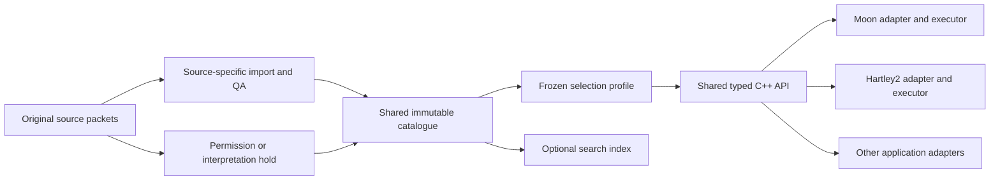

# Proposal: a shared AMPS chemical database

Prepared 2026-11-18. **Historical design proposal; an initial shared database
has now been implemented and installed.** The actual archive is
`/data/vtenishe/CHEMICAL_DATABASE`, as subsequently requested by the user.
Its [installed README](/data/vtenishe/CHEMICAL_DATABASE/README.md),
[source tools](../utility/chemical_database/README.md),
[shared C++ API](../src/models/chemical_database/README.md) and
[test contract](../test/chemical_database/CONTRACT.md) describe the delivered
interfaces. The implementation includes the permission-aware source catalogue,
immutable runtime export, Python/CLI and portable C++17 SDK, and shared Moon
scalar-service compatibility aliases. The initial `catalogue-v1` profile
supports catalogue/source/table access; it does not activate physical reaction
transport. Broader application-profile migration, including Hartley2, remains
future work. Paths, commands and interfaces explicitly described as proposed
below retain their original design status unless the implementation documents
state otherwise. See `srcMoon/STATUS.md` section 5.30 for actual verification.

## 1. Recommended outcome

Create **one versioned chemical catalogue, one data-access API and one set of
source-processing tools** shared by all AMPS applications. Put maintained code
under `src/models/chemical_database/`, preparation/query tools under
`utility/chemical_database/`, and the persistent numerical archive outside
application and test-output directories. The proposed local archive root is
`/data/vtenishe/amps_chemistry_data`; installations elsewhere supply their own
root explicitly. Nothing should depend on that particular absolute path.

Use an immutable release directory containing strictly specified JSON
metadata and CSV numerical tables, original source objects addressed by
SHA-256 and named selection profiles. Generate detached immutable runtime
exports using typed CSV plus the existing AMPS block grammar, so
C++ needs no new JSON parser. A generated SQLite search index is an
optional convenience for Python tools. It is rebuildable and never a second
authority or a required C++ dependency. Production opens a frozen release,
validates the requested profile and loads immutable typed data before particle
transport. It performs no network acquisition or database writes during a run.

Retain alternative publications, solar cases, state populations and model
approximations explicitly. A common database must not average conflicting
measurements, merge physically different channels, turn an absorbed-photon
total into a chemical event, or promote research downloads to qualified
transport. Data consolidation and physical qualification have separate exits.

Every acquired source receives an inventory entry. Numerical integration is
subject to the actual source permissions. In particular, current OPEN-ADAS
terms explicitly cover insertion into a managed database; an external/private
path alone does not resolve that restriction. Such sources initially receive
metadata/link-only entries pending the required permission. No author or data
provider is contacted by this proposal.

Proposed data flow:



The hold branch contributes source/issue metadata; it contributes numerical
payload only when that operation is permitted and its interpretation is sound.

## 2. Current implementation and evidence

Source basis: `74974c2b2fc1b4cf09a73c320064a22370c0ca94` plus the already
recorded uncommitted development. Two parallel read-only audits examined
shared/comet execution interfaces and acquired data/permissions. This document
does not claim a complete audit of every chemistry consumer in AMPS; an
all-application call-site scan is the first implementation deliverable.

| Existing location | What is already available | Constraint for sharing |
|---|---|---|
| `/data/vtenishe/moon_validation_data/photochemistry/` | Original PHIDRATES and Voronov data, processing scripts, provenance, QA and processed products | D04/D05 are logical datasets in this same physical package; existing raw paths and frozen identities must remain reproducible |
| `srcMoon/species/Photochemistry.{h,cpp}` | Source-authenticated complete D04 registry, quiet/active rates, channel selection and explicit photon visibility scaling | The namespace/schema are Moon-specific; rates do not establish daughter-state or velocity laws |
| `srcMoon/species/ElectronImpact.{h,cpp}` | Full native Voronov parser and four neutral-atom Maxwellian coefficient evaluators | Electron distribution, temperature convention, density and validity must remain explicit |
| `srcMoon/species/ChargeExchange`, `SodiumPartialCapture` | Named He/Na total-rate services and separate native-node Na ground-product partial reference | Ordered projectile/target identities, partial/total meaning, state gaps and distinct source domains must survive |
| `srcMoon/species/ReducedKinematics`, `HeliumSilicaChargeSurvival`, `IonCollector` | Source/state-explicit recoil, conditional laboratory law and artificial collector accounting | Mathematical models and boundary policies are not measured chemical coefficients; the collector is not lunar material data |
| `src/models/chemical_solver/ReactionNetwork.h` | Application-independent reaction topology, rate laws, validation and per-parent channel index | Its compiled indices, three rate forms and single excess-energy field are an execution view, not a complete canonical database schema |
| `src/models/chemical_solver/ChemicalSolver.h`, `ChemistryDiagnostics.h` | Continuum integration and geometry-independent diagnostics | Keep their solver/diagnostic contracts; the catalogue supplies selected inputs, not a replacement integrator |
| `src/models/cometary_physics/CollisionDatabase.h` | Validated neutral-pair collision data and bounded temperature laws | Neutral pair lookup is unordered; projectile/target CEX data are directional |
| `input/CometPhysicsDatabase.pm`, `CometReactionNetwork.pm`, `input/hartley2.pl` | Rubin2011 catalogue, explicit collision-completion tiers, species binding and generated tables | Preserve interfaces, precedence, channel order and intentional neutral-only sinks; the existing `+` splitting cannot parse charged identifiers directly |
| `srcHartley2/CometChemistry.cpp`, `CometRuntimeInput.cpp`, `CometPhysics.cpp` | Production executor, startup rate overrides, temperature/collision application policies | Startup topology/cache freeze and number-rate semantics differ from Moon physical-number transport |
| Shared `photolytic_reactions`, `electron_impact`, `charge_exchange` modules and other applications | Existing source tables/evaluators and active legacy consumers | Inventory and migrate source by source; no global replacement based on a matching species name |

The canonical package audit verified all 11 recorded processed-output hashes
and six recorded processing-script hashes, as well as all 178 inventoried raw
files, with no mismatch. Its current
tables contain 17 channel records (15 reactive and two absorption totals),
30 solar-endpoint rate rows, 2,305 cross-section rows, 1,460 derived branch
rows, four threshold rows, 406 Voronov fits and a four-neutral subset. The
21-row combined index is a view of these sources, not 21 additional independent
measurements. These are inventory/identity findings, not new science-test PASS
results or a reclassification of the complete package as READY.

Additional research sources are currently retained under
`<AMPS_ROOT>/test_output/srcMoon/`:

| Packet | Intended catalogue coverage | Existing limitation to preserve |
|---|---|---|
| `m3-approved-products-20261118T163142Z/source-acquisition-v2/` | NIST isotope masses, constants and H/Na thresholds | Complete molecular/isotope/state/energy crosswalk is missing |
| `m3-oxygen-cascade-sources-20261118T170845Z/acquired/` | NIST ASD 5.12: 614 levels, 910 lines and the stored five-level/twelve-component selected graph | All stored lines are not a certificate of all physical exits; retain 56 missing A values and null physical lifetimes/normalized branches |
| `m3-atomic-online-databases-20261118T083400Z/` | NIST, Phelps, IAEA and OPEN-ADAS atomic/electron/capture references | Restricted permissions, incomplete outgoing distributions, partial/composite channel distinctions and native initial-state gaps |
| `m3-molecular-databases-20261118T083551Z/` | Leiden, ExoMol, MPI-Mainz, UMIST and KIDA references | Different radiation fields; retained negative samples/nonclosing partials and metadata discrepancies; source-specific permission review |
| `m3-ion-surface-cex-data-sources-20261117T225600Z/` | He/silica, silicate/regolith and capture publications/tables | Conditional laboratory outputs, incomplete numerical support and material/geometry restrictions |

The repository's comet/Huebner tables, documented neutral collision estimates,
and existing Na/Ar surface-parameter sources also belong in the initial
inventory. Their origin is an existing implementation/reference, not a newly
acquired measurement. Mission observations, LOLA/Diviner maps, plasma time
series and run-generated plots remain in their own archives; the chemical
catalogue may reference those packages without absorbing their observations.

Research-packet identity checks covered 153 atomic files, 44 molecular
retention-manifest files, 30 ion/surface packet files and 16 O I acquisition
responses, with no hash mismatch. These counts are per manifest and are not
summed as independent experiments or science tests. An index entry may describe
a retained failed retrieval or document as well as a numerical dataset.
The reproducible read-only audit totals 449 hash checks and nine count checks
across 448 unique observed inputs, with zero mismatches. It preserves the
initial root-discovery guard refusal and corrected invocation separately.
These are documentary checks, not science tests or permission clearance.

## 3. Data ownership and storage

Proposed persistent data layout:

```text
<CHEMISTRY_DATA_ROOT>/
  README.md
  registry/                         release IDs and review records
  objects/sha256/<digest>/          immutable permitted source/derived bytes
  releases/<release-id>/
    release.json                   schema, membership, hashes, review scope
    catalogue/                     JSON records plus canonical CSV tables
    profiles/                      exact dataset/model selections
    provenance/                    source and processing graph
    qa/                            integrity and scientific gap reports
    licenses/                      native terms and permission evidence
    SHA256SUMS
  exports/<release-digest>/<profile-digest>/<codec-version>/
    export.in                      detached runtime manifest, existing grammar
    tables/                        typed deterministic runtime views
    SHA256SUMS
  indexes/<release-digest>/         optional disposable SQLite search index
  work/<unique-import-id>/          incomplete imports, never runtime input
```

The release's catalogue/profile records are authoritative selections; the
object store retains exact bytes. An object digest is a storage identity,
not a claim of physical equivalence. Different observations or sources with
identical numerical values retain their separate provenance edges even if
their identical file bytes share storage. Failed/challenged HTTP responses
are retained as acquisition diagnostics, not parsed as numerical sources.

Release records use relative object references and stable logical source IDs,
not paths containing a checkout, home directory, username or timestamped
`test_output` name. Exact original filenames/paths remain in provenance as
historical locations. A release is relocatable together with its required
objects. An installation resolver is the only component that joins logical
references to a selected root; it must reject path traversal outside that root.

Do not move/delete current canonical raw files. First copy permitted bytes,
verify hashes, retain an old-to-new location map and replay processors.
Retain current research packets until copy/QA and reproducible-import evidence
are reviewed. After cutover, test artifacts refer to persistent source IDs;
ordinary cleanup of `test_output` must no longer remove a required source.
The new root is proposed, not created by this work.

The hash graph must be acyclic. Canonical `release.json` binds its source,
catalogue/profile and processing members; it does not contain its own hash or
the hash of a runtime export that cites it. A detached `export.in` then cites
the final release/profile digests, export codec and runtime-table hashes.
The application receipt pins both release and export digests. The export is a
reproducible projection of the same catalogue, not an independently edited
database. A checksum listing also does not hash itself. Tests explicitly
rebuild and compare this projection and reject inconsistent bindings.

Maintain code, schemas, processing recipes, small approved reference fixtures
and review records in AMPS Git. Maintain bulk permitted data as separately
versioned immutable data releases. The existing validation-data repository
retains D04/D05 descriptors and their frozen release mappings. Do not place
restricted numerical bytes or bulk downloaded papers in AMPS Git. Decide
backup/storage ownership before retiring any existing copy; no backup is
assumed to exist merely because a digest was recorded.

### Format decision

V1 uses UTF-8 JSON metadata and strict, versioned CSV schemas. Metadata
describes each table's typed columns/axes, units, null semantics, source order,
domains and relations. Preserve original decimal strings/qualifiers alongside
derived numerical values. Use explicit validity/status columns for unknown
numbers; a blank numeric field never silently means zero. Schema validation
rejects duplicate keys/IDs, malformed values and unexpected columns.

JSON is the review/tooling representation. The native loader consumes the
schema-defined CSV/runtime-block projection and authenticates the bound JSON
bytes without interpreting arbitrary JSON. All runtime-required units, domains,
state/energy distinctions, gap/permission/capability flags and source IDs must
survive that projection. An unsupported field cannot be dropped to manufacture
a compatible runtime export. There is no automatic export generation at run
startup; missing or incompatible prepared exports remain explicit failures.

Native HDF5, PDFs, HTML, Fortran/ASCII tables and network archives remain exact
source objects. Supported normalized tables can be extracted reproducibly;
unsupported multidimensional products stay indexed but unavailable. Do not
flatten correlated product distributions into independent marginal tables.
If measured future workloads justify another normalized array format, add a
versioned codec and independent round-trip tests before adopting it. No new
custom binary format or HDF5 runtime dependency is needed for the first release.

SQLite is optional tooling for joins/search. It is an embedded database, and
Python exposes it through an optional standard-library module. The module
must be detected, not assumed present. On this machine Python's module is
available, while `pkg-config` does not find a C SQLite development package;
that observation does not prove no C installation exists. Keeping runtime
consumers independent of SQLite avoids introducing that build requirement.
See [Python sqlite3](https://docs.python.org/3/library/sqlite3.html) and
[SQLite intended uses](https://www.sqlite.org/whentouse.html).

## 4. Canonical scientific schema

Use structured identities and relations. Reaction-equation strings are
display labels; never parse charges or stoichiometry by splitting on `+`.
Opaque stable IDs have a namespace/version and do not encode an AMPS species
index. A scientific identity and a source's particular assertion are separate.

| Entity | Required content and invariants |
|---|---|
| `source` / `source_object` | Provider, source/product version, DOI/URL, original name, retrieval interval, native metadata, SHA-256, size, rights evidence, acquisition outcome and source locator |
| `chemical_species` | Element/isotope composition where supplied, integer charge, phase and isomer/isotopologue identity; unspecified isotope mixture stays explicitly unspecified |
| `state` | Species ID, exact electronic/rovibrational/fine/hyperfine labels where supplied, state-source identity and unresolved qualifiers; no inferred ground state |
| `mass_definition` / `energy_reference` | Measured physical vs additive model mass, constants version, electron convention, formation/excitation energies, named energy zero, uncertainty and validity; consistent crosswalk required before Q evaluation |
| `reaction` / `reaction_term` | Ordered projectile/target roles where meaningful, structured reactants/products, state references and complete/aggregate product meaning; elementary particle events have exact integer multiplicities, while explicitly labelled continuum mechanisms may retain source-defined fractional coefficients |
| `dataset` / `assertion` | Source-specific claim, measurement/theory/evaluation/fit/estimate/reduced-model origin, native conditions, processing identity, links to reaction/state and distinct parent/child aggregation relationships |
| `quantity` / `table_axis` | Hazard, coefficient, cross section, differential cross section, spectrum, A value, state energy, material response or model parameter; dimensions, native and normalized units, axis meaning/frame and support intervals |
| `rate_model` / `distribution_model` | Named/versioned implemented law, source parameter references, input distribution/spectrum, interpolation rule, endpoint inclusivity, missing support, error/validity assumptions and complete output meaning |
| `radiative_transition` | Upper/lower state, multipole component, A value, wavelength convention, accuracy qualifiers and missingness; listed graph is distinct from a complete physical decay network |
| `material` / `surface_response` | Composition/isotope/surface preparation, roughness/state/temperature, projectile state/energy/incidence, detected exit class, geometry and conditioning/normalization; survival among scattered particles differs from incident retention |
| `uncertainty` / `correlation_group` | Reported error type, confidence if provided, bounds/systematics/covariance and missing fields; no invented fixed sigma or independence |
| `processing_step` | Input/output digests, script revision/hash, dependencies, exact transformation, conversion/filter/selection parameters, output record counts and rejected records |
| `coverage` / `issue` | Complete, partial or unknown support, contradictions/negative source values, missing thresholds/states and affected operations; unresolved issue blocks only the capabilities it actually affects |
| `profile` / `compatibility_mapping` | Frozen source/model/parameter selection, requirement on capabilities, compiled-species/state mapping policy, explicit bath/sink semantics and legacy conversion provenance |
| `review` / `qualification_evidence` | Review scope/version, source/model/build/input identities, oracle/gates and actual results; application qualification is never a global database boolean |

Data values retain native meanings. Normalization to SI must be a documented
operation with source/constants identity. A per-parent loss frequency [s^-1],
a two-body coefficient [m^3/s], and a three-body coefficient [m^6/s] are different
types. Energy per projectile atomic-mass unit needs its energy/mass convention;
it cannot become a speed without explicit applicable masses and kinematics.
Electron temperature in eV and kinetic temperature in K remain distinguishable.

Store source total/partial/nested channel relations explicitly. Selecting
resolved children and their aggregate parent together is rejected as double
counting. Missing channels are not zero-probability branches. Experimental
and theoretical OH, D04 endpoint spectra and ISRF-based rates keep separate
IDs. Cross-source equivalence requires a documented mapping; equal chemical
formulas alone do not establish identical states, spectra or experiments.
`OH_exp` is an experimental source variant, not an excited-state label.
An integer-particle executor refuses fractional continuum terms rather than
inventing fractional product molecules. Legacy continuum/custom mechanisms
remain representable and retain their appropriate conservation contract.

Current source issues must survive migration: the retained Leiden water file
has 343 negative samples in each OH/O/total-dissociation array, and ExoMol's
OH export has 19,173 actual rows against 19,172 declared. The D04 He 51.75nm
and Ar 82.49nm positive samples also require interpretation relative to their
listed ground-state thresholds. Preserve these native records and issue
locators; do not silently repair them or infer that a separate frozen
integrated-rate baseline is thereby invalid.

### Separate readiness dimensions

Each record/profile reports at least:

1. Acquisition/integrity: missing, acquired, corrupt or hash-verified.
2. Interpretation: native metadata resolved, partial or unresolved.
3. Permission: numerical managed storage/evaluation/distribution allowed,
   prohibited/pending, unknown or not applicable; retain evidence per action.
4. Available capability: source-only, scalar evaluation, conditional operator,
   declared reduced products, complete products, etc.; each lists prerequisites.
5. Evidence: specific local/linked/observational gates and identities.

These are independent. A successful import may leave a source partial or
quarantined. `PASS/FAIL/ERROR/SKIPPED` remain test outcomes;
`VERIFIED/VALIDATED/EXPERIMENTAL/DISABLED` retain their existing capability
meanings. Neither a hash nor `allow_experimental` grants missing physics,
rights, measured forcing or an observational-validation claim.

## 5. Shared C++ and Python interfaces

Proposed namespace: `AMPS::ChemicalDatabase`. The base library uses C++17 and
the standard library, with no PIC, MPI, SPICE, Moon/comet headers, network,
database-server process or automatic random draws. Parse/schema/hash utilities
are shared; application wrappers preserve their existing public interfaces.

Proposed operations, illustrated as API contracts rather than implemented code:

```text
OpenRuntimeBundle(root, pinned_release, pinned_profile, pinned_export_codec_and_digest)
ResolveProfile(profile_id, expected_profile_digest, requested_capabilities)
FindSpecies / FindState / GetReaction / ListAssertions
BindCompiledSpecies(explicit_mapping, mass_and_state_policy)
PrepareRateEvaluator(selected_assertion, declared_context_contract)
PrepareProductModel(selected_model, explicit_energy_state_contract)
EvaluateRate / EvaluateCrossSection / EvaluateConditionalResponse
ExportProvenance / ExplainUnavailable / EstimateRequiredStorage
```

Return a typed outcome: `Evaluated`, `Unavailable`, `InvalidInput`,
`OutsideDomain`, `CorruptSource`, `UnsupportedSchema`, `PermissionRequired`,
`NumericalFailure` or `ResourceLimit`. Never return physical zero as a missing
record/domain/metadata sentinel. Queries are transactional: failure preserves
previous immutable handles and output arguments. Required unavailable inputs
stop normal production preflight with an actionable error; test runners map
genuine unavailable prerequisites to SKIPPED and corrupt/build/runtime failures
to ERROR. A violated evaluated science criterion is FAIL.

Native lookup is bounded by the loaded bundle; records outside its declared
coverage return Unavailable without lazy file/network acquisition. Metadata
may identify a known but restricted/unloaded dataset without supplying its
numerical payload. Python tools support full-release catalogue searches.

The numerical hot path receives a prepared evaluator with fixed typed inputs;
it performs no file/hash/profile lookup or allocation for every particle.
Unknown model identifiers are refused; no arbitrary scripts or formulas from
downloaded metadata execute inside AMPS. Supplied RNG streams belong to the
application/model adapter and retain their existing sampling ownership.

Python tooling provides `import`, `inspect`, `query`, `explain`, `verify`,
`build-release`, `export-legacy` and `diff-release`. Names are proposed CLI
subcommands, not available commands. Query can use the optional derived SQL
index, with index-to-release digest checks. Fetch is a separately invoked
preparation operation, subject to source terms and explicit network access.

Loaded catalogue storage and prepared handles own their data. Compatibility
views for the existing non-owning reaction/collision containers retain an
immutable storage owner, including all referenced arrays and source strings.
No raw view may outlive that owner. Finalize vectors/indices before publishing
handles; forbid mutation/hot reload after application initialization. Concurrent
host queries use const data and caller-owned outputs; mutable caches/diagnostics
need explicit ownership. V1 evaluation is host-side; CUDA/device execution
must not be inferred from CPU checks. Existing GPU builds must either link the
host service correctly or reject an unsupported selection explicitly.

Canonical serializers and versioned runtime projections implement the same
published scientific schema. Source-specific importers
remain separate to preserve source meaning, and generate one catalogue format.
Application tests call the same C++ production evaluators; independent test
oracles must not simply call the importer's formula a second time.

### Application-owned behavior

Moon/comet/other adapters own geometry, illumination, epoch/frame transforms,
plasma distributions, material selection, thermal state, source populations,
particle weights/local time, AMR ownership, event execution, sampling and
checkpoint policy. The database records conditions and evaluates the selected
law; the application supplies the actual conditions and verifies applicability.

Moon's particles carry represented number `N=W*correction`; Hartley2's steady
flow executor uses represented number rate and normalized remaining fractions.
Sharing input data must not exchange those executors, units or conservation
ledgers. Preserve existing neutral sinks explicitly in legacy profiles; a
projection to zero tracked products is a model decision with a recorded bath/
sink, not a physical reaction with no products.

## 6. Configuration, profiles and reproducibility

Extend the existing block grammar in `src/INPUT_FILE.md`. The shared owner
parses a proposed `#begin physics: chemistry` block through
`src/general/input/amps_input.h`. Do not create another input dialect. Example
below is a proposed future receipt with explicit placeholders, not a runnable
current input or fabricated release identity:

```text
#begin physics: chemistry
  database_root = /data/vtenishe/amps_chemistry_data
  release_id = <reviewed-release-id>
  release_manifest_sha256 = <actual-manifest-digest>
  profile_id = phidrates-endpoints-legacy-v1
  profile_sha256 = <actual-profile-digest>
  runtime_export_codec = csv-block-v1
  runtime_export_manifest_sha256 = <actual-export-manifest-digest>
  requested_capability = scalar-rates
#end physics
```

Moon and Hartley2 adapters may select the same profile when their declared
conditions and compiled representations permit it. Distinct legacy profiles
are required for D04 endpoints, legacy Huebner/Rubin, I3 Moore–Mapaye activity
and collision completion, and approved experimental reduced kinetics. Exact
IDs are established during import review; the names here describe proposed
roles. There is no automatic "best/latest" source selection or fallback.

Resolve relative `database_root` paths from the declaring input file, following
the existing include semantics. An optional `AMPS_CHEMISTRY_DATA` environment
fallback is accepted only when the root key is absent; record the resolved
value and origin, and retain explicit release/profile hashes. Do not search
multiple home/check-out paths or silently choose an installed latest release.

The application performs startup binding against its actual compiled table.
Do not silently replace mixture-average legacy masses with isotope/reference
masses, collapse excited states, assume missing ground states or alias a charge
state to a neutral. An explicitly legacy coarse representation may retain its
existing scope. A state-resolved request requires compatible compiled storage,
mass/energy policy and event model. Changing those is a separate reviewed
physical configuration and may require a clean rebuild.

Binding therefore has two phases. Compile-time `.input`/Perl generation fixes
the species/topology/storage contract and emits its fingerprint. Runtime `.in`
selection must match that fingerprint and the selected export's state mapping.
Only parameters permitted by the existing application startup contract may
change before the rate cache is frozen. A runtime file cannot introduce new
species/topology, alter product-count offsets or bypass a rebuild merely by
selecting another catalogue profile. Legacy coefficient overrides are recorded
as explicit derived run-model inputs; they do not edit the source release.

Every run records release/profile and evaluated-data digests, selected models
and parameters, compiler/source/executable identity, actual compiled mappings,
constants and energy zeros, unresolved but permitted limitations, seed/streams,
MPI/OpenMP layout, context/geometry input references and citation list.
Checkpoint manifests pin these identities; mismatches refuse restart unless a
separately specified, tested migration exists. This proposal adds no permission
to implement an unqualified common-time particle restart.

## 7. Source permissions and publication policy

The retained ADAS native files and current official terms explicitly require
permission for insertion into a managed database and redistribution with code.
Their catalogue entry therefore contains bibliographic/availability/permission
metadata only until the required written authorization is obtained. Do not
move numerical arrays into a "private cache" to bypass that condition.
See [OPEN-ADAS terms](https://open.adas.ac.uk/terms-and-conditions).

LXCat's current policy directs third-party users to obtain data from LXCat
and does not grant blanket third-party redistribution. Retain applicable
contributor terms/citations, and do not bundle restricted data in a release.
A personally acquired original Phelps paper and an LXCat export have distinct
provenance/rights records; one does not authorize redistribution of the other.
See [LXCat redistribution policy](https://nl.lxcat.net/instructions/redistribution.php).

The retained Tellez publisher PDF also distinguishes permitted private research
copying from further distribution. Preserve its original notice and review
permissions separately for the paper, extracted table and proposed release;
an open numerical source and its publisher's PDF need not have the same
redistribution conditions.

For NIST, PHIDRATES, IAEA, Leiden, ExoMol, UMIST, KIDA and published papers,
record the actual applicable data/article terms and requested operation. Public
downloadability or a webpage copyright footer is not a blanket release licence.
For example, a JavaScript vendor copyright on a UMIST page is not the RATE22
data licence. Rights-unresolved sources remain indexed and unavailable for
the restricted operation. No user approval of this technical plan substitutes
for a provider's required permission.

The logical catalogue can therefore inventory every source while exposing a
smaller distributable numerical release. It must report missing/restricted
objects explicitly when a profile requests them. Written permission requests,
if desired, require separate authorization to contact providers; none is sent.

## 8. Migration without changing selected physics

### Work package A — inventory and contract

Inventory every chemistry consumer, table, formula and hard-coded selection
across AMPS, including Moon, Hartley2/I3, Enceladus and the generic shared
modules. Record source/version/state/units/domain, native rights, exact caller,
compile/runtime switches, generated-table order and test coverage. Separate
measurements, source models, estimates, numerical closures and application
policies. Produce the import manifest, schema, named legacy selections,
permissions register and complete old-to-new ID map before changing evaluators.

### Work package B — persistent source capture and import

Import permitted sources from existing immutable bytes; no new fetch is needed
when a valid original is present. Keep restricted sources metadata-only. Move
no canonical originals. Migrate maintained processors out of Moon-specific
test directories into shared tooling, preserving old CLI wrappers and frozen
input/output evidence. Produce normalized data and source QA transactionally
in `work/`, then publish a new immutable release after review. Keep known
negative samples, missing uncertainty, duplicate wavelengths, incomplete
states and spectral support gaps; record refusal of unsafe numerical use.

An import/release manifest must account for **every** input: imported numerical,
retained original/reference, metadata-only permission hold, unsupported format,
failed acquisition or duplicate storage object. No silent omission is allowed.
The complete inventory includes old alternative/composite datasets without
making all of them production-selectable.

### Work package C — common loader and unchanged-profile evaluation

Extract and reuse reviewed Moon source authentication/parsing/evaluators with
the same mathematics and failure domains. Add schema/capability-aware typed
interfaces and the shared grammar owner. Reuse existing network/collision
containers as execution views. Keep continuum integration and particle
execution outside the new data layer. Do not rewrite every existing solver.

The normal build path is `Config.pl`/`ampsConfig.pl` plus Make; this checkout
has no root CMakeLists.txt. `ampsConfig.pl` copies `src/*` into the generated
tree, so the new shared source directory will be present. The proposed minimal
build integration is uniquely named `ChemDb*.o` objects compiled through
`src/general/makefile` from `../models/chemical_database/`; the existing root
archive rule already includes `general/*.o`. Verify that path with the actual
configured compiler before adopting it. This is a small shared-core build
change and requires core preservation tests. Keep the root Makefile untouched
and uncommitted. No active generated `build` copy is the primary source fix.
Unique member names avoid the archive replacement issue already encountered
between Moon and upstream `ChargeExchange.o`.
Add the objects to `GENERALOBJ` and explicit source/header dependency rules;
the default `.cpp` rule does not search the new source directory. Preserve the
configured `COMPILE.mpicxx`/`FLAGCC` settings. Include a host/CUDA build-path
check where applicable: the current CUDA path renames general `.cpp` files,
but does not automatically transform the proposed shared model directory.

### Work package D — Moon adapter and preservation

Retain public Moon wrappers and explicit old ID/source-hash mappings while
they delegate to the shared service. Preserve current quiet/active scalars,
native-node/total-CEX distinctions, exact legacy default behavior and neutral
nightly reference. The new shared profile is introduced alongside the current
configuration until equivalence gates pass. Global U15/U16/U17 supporting
children and existing linked paths exercise the common implementations.
Physical event-provider activation remains a separate data/model/wiring gate.

### Work package E — Hartley2 and second-consumer verification

Keep `CometPhysicsDatabase.pm` as a compatibility façade. A shared export tool
provides selected existing-profile tables; the Perl layer retains compile-time
species binding and byte/semantic-compatible generation. Preserve source
ordering, neutral sink semantics, collision-completion precedence and startup
rate overrides before `GetNetwork()` freezes its cache. Introduce typed
charged/state-resolved records through a new structured adapter, never by
feeding `H+` strings into the old `+`-splitting parser.

Keep sampled-temperature floors, undersampling policies and upper-temperature
clamping from `CometPhysics.cpp` in an explicit legacy application policy.
They are not generic data corrections. Preserve I3 solar-proxy rates and its
fixed-energy choices separately from Rubin/D04. Converting UMIST's
`alpha*(T/300)^beta` to the core's `A*T^beta` requires a documented unit/law
transformation; merely copying coefficient names would change the physics.

### Work package F — release, other consumers and retirement

Prove Moon and at least one second application use the same release and
shared evaluator without an application namespace dependency. Extend adapters
for the remaining inventoried applications incrementally. Keep legacy source
paths/wrappers until every live consumer has a tested migration. Retire
duplicated formulas only after equivalence, core preservation and review.
Freeze initial release/citations/permission scope, prepare backup and transfer
instructions, and make new data additions use the shared import pipeline.

Each work package produces reviewable artifacts and can be delivered
independently. No credible total calendar estimate is established yet: rights
permissions, additional consumers and unresolved scientific metadata are
external dependencies. Package A supplies a measured size/effort estimate;
implementation must not conceal those dependencies in a fixed completion date.

## 9. Verification procedure and acceptance

Create one proposed shared runner at `test/chemical_database/run_all_tests.py`,
with individual test directories, independent references and CSV/PNG/EPS
comparisons where a scientific comparison is meaningful. Register shared
coverage with the core catalogue and Moon/comet aggregators consistently.
Descriptive groups below are specifications, not assigned permanent test IDs.
Preserve all frozen U01–U26/I01–I46 meanings and thresholds.

All groups inherit this common test contract; row-specific inputs/oracles
below override only the stated fields:

| Contract field | Required specification |
|---|---|
| ID/name, purpose | Descriptive shared component group; assigned ID only through registry review; distinguish integrity, evaluation, wiring, conservation and validation |
| Production capability/entry points | Actual shared loader/evaluator/exporter and normal Moon/Hartley2 adapters, never duplicate test-only rate laws |
| Configuration/inputs | Frozen release/profile, exact schema/source versions, explicit compiled species and declared physical context; negative fixtures are copies/analytical software inputs, never invented observations |
| Independent reference/oracle | Native source locators, independently evaluated formula or exact invariant; reviewed regression only for declared legacy preservation |
| Units/frame/time | Every quantity/axis is typed; source-rest/COM and spectrum/epoch conventions stated; pure integrity tests mark physical frame/time not applicable |
| Deterministic/stochastic controls | Exact source ordering and repeatability for unchanged tables; existing seeded statistical contracts retained; no new guessed confidence/physical tolerance |
| Procedure | Verify required source hashes/permissions/metadata, load/resolve, evaluate actual production path, compare independent oracle, retain refusal outputs and all artifacts |
| Metrics/acceptance | Exact IDs/counts/lexical preservation where specified; source precision and frozen independent arithmetic bounds; existing numerical/statistical/physics gates unchanged |
| Expected PASS/failure modes | Correct quantity/domain/identity or explicit transactional refusal; wrong units, stale hashes, double counting, silent source substitution or missing data treated as zero fail |
| Required data/hashes | Pin actual input and oracle digests before execution; no placeholder digest is runnable evidence; unavailable permitted data means SKIPPED |
| Predecessor gates | Shared integrity/evaluator tests before adapters; existing application convergence/qualification order before science claims |
| Artifacts | stdout/stderr, result/manifest, commands, input/profile snapshots, source/build/executable/data identities, seed/layout, detailed metrics and comparisons |
| Status semantics | PASS evaluated/met; FAIL evaluated/missed; ERROR corruption/build/parser/runtime/infrastructure; SKIPPED required capability/dependency/authoritative data absent; source QA is never linked validation |

| Group | Production path and independent oracle | Specific acceptance and failure coverage |
|---|---|---|
| Source/permission inventory | Importer/permission gate; native manifests, terms and source locators | Every source accounted for; restricted numerical import refused; immutable raw digests unchanged |
| Schema and identity | Shared loader and profile resolver; independent schema cases | Duplicate IDs/keys, missing required metadata, path traversal, stale hashes, invalid references/unknown schema refused transactionally |
| Species/state/energy | State resolver/binder; exact integer nuclei/charge and independent energy/reference-mass calculations | Preserve multiplicity, unknown state and all separate energy terms; reject incompatible compiled mass/isotope/zero conventions |
| Rates, units and domains | Same production scalar/cross-section evaluators; high-precision source formulas/native nodes | D04 endpoints, Voronov, total/partial CEX and Arrhenius transformations retain source bounds; coefficient/hazard and ordered/unordered pair confusion refused |
| Missing/contradictory source data | Normalized source reader; exact native samples and native metadata | Retain negative/unresolved raw values, missing A/uncertainty, disjoint support and row discrepancies; unsafe evaluator remains unavailable without clipping or renormalization |
| Aggregate/channel selection | Profile resolver; complete original source family and independent sum/partition identities | No simultaneous aggregate-plus-children double count, absorption events or silent removal of an unsupported branch |
| Model/uncertainty distinctions | Prepared model/conditional response; independent analytic/source law | Mean energy not a measured joint PDF; He scattered-charge fraction not retention; missing confidence/covariance remains missing |
| Legacy export | Shared exporter through existing Perl/C++ façades; old reviewed generated tables and channel order | Exact unchanged-profile generation where byte identity is required; explicitly reviewed formatting-only differences otherwise; species reordering changes indices, not chemical meaning |
| Moon actual runtime | Normal callbacks/movers/chemistry; existing independent U/native/M0 references | Same-layout RNG/default output preserved; actual one/eight-rank new paths, reviewed four-rank `make -j test_Moon`, zero-byte diff; no automatic reference update |
| Hartley2 actual runtime | Normal `GetNetwork`/rate overrides/executor/collision adapter; existing parser/packet/forcing/source-budget tests | Preserve startup freeze, number-rate accounting, source precedence and legacy sinks; same data available through shared API |
| Relocation/release/limits | Same loader, offline root relocation and resource preflight | Complete release works in another directory without network/site paths; wrong/incomplete root is explicit; size/resource refusal does not partly publish data |
| Core preservation | Existing full core runner/comparison tools and prior passing-case manifest | Every previously PASS case remains PASS with no missing IDs; historical FAIL/ERROR remain identified; no waived threshold or refreshed reference |

The schema/identity and legacy-export groups also cover the acyclic release/
export hash graph, unsupported projection fields, compiled-topology mismatch,
fractional-continuum versus integer-particle binding, storage lifetime and
concurrent const host queries. These are software contracts, not additional
observational gates. Tests of host linkage do not claim verified GPU chemistry.

The proposed development profile has a **3600-second total wall limit**,
including setup, clean builds, comparisons, restoration and reporting; default
8 MPI ranks/OMP1, explicit 1-rank controls and a 200GB aggregate process-tree
RAM ceiling. No duration is guaranteed before measurement. Schedule the fast
source/schema/evaluator suite first, then affected Moon/comet checks, retaining
a measured restoration reserve. If required core preservation or long stochastic
qualification does not fit, run it as a separately declared cluster package
within the approved few-hundred-CPU-hour tier; the affected merge/qualification
gate remains open until those results exist. Do not drop tests or relax
tolerances to label the development profile complete.

Builds follow the user's rule: remove generated `build`, normal Config.pl,
then `make -j`, in disposable directories outside the active tree. Record the
actual compiler/macros, source revision, generated identities, rank/thread
layout and all commands. The library returns resource diagnostics; application
adapters use `exit(__LINE__,__FILE__,msg)` with requested bytes/records, actual
limit and concrete ways to reduce selected data/chunks or available concurrency.
No hidden fixed truncation, loss of channels or invented tail clipping is allowed.

## 10. Completion criteria and decisions to review

Initial shared-database delivery is complete only when every inventoried source
has an explicit disposition; permitted sources are reproducibly represented;
restricted sources are metadata-only; a relocatable frozen release and shared
API exist; Moon and a second application consume them through normal paths;
unchanged-profile comparisons and required historical core PASS membership
are preserved; and relevant READMEs, manual/input ownership and registries
describe actual behavior. It does **not** close M1/M2/M3 or missing chemistry
data/model/observational gates.

| Decision label | Recommendation | Consequence |
|---|---|---|
| SDB01 | One portable immutable JSON/CSV catalogue with hashed source objects; optional derived SQLite search index | No C++ SQL/HDF5/server dependency in V1; explicit future codec review |
| SDB02 | External persistent root `/data/vtenishe/amps_chemistry_data`, relocatable and configurable | Shared data leave test-output ownership; existing originals retained during migration; storage/backup owner must be designated |
| SDB03 | Standard-library C++ service in `src/models/chemical_database` plus shared tools, with minimal normal-build integration and compatibility façades | Reuse existing formulas/solvers; root Makefile preserved; actual shared-core wiring requires preservation evidence |
| SDB04 | Import all sources into the inventory, preserve alternatives/unknowns and use pinned named profiles | No automatic source ranking, repair, physical activation or legacy reference replacement |
| SDB05 | Enforce source-specific managed-storage/evaluation/redistribution permission gates | ADAS and other uncleared sources initially metadata-only; no external contact without separate authorization |
| SDB06 | Migrate Moon first and Hartley2/I3 second, then remaining inventoried consumers | At least two normal applications prove sharing; their distinct particle/continuum/time/weight semantics remain explicit |
| SDB07 | Make acquisition/import and release review separate from production configuration | Offline reproducible runs; no runtime downloads or mutable latest release |
| SDB08 | Keep one-hour monitored development packages and mandatory longer preservation/qualification gates when needed | Unfinished expensive gates remain open rather than being omitted |

These labels are proposal decisions, not new test IDs. Approval would authorize
the stated software/data-migration scope. Dataset permissions, missing science
metadata, independent oracles and physical qualification still require their
own evidence. Storage ownership/backup destination and whether to authorize
provider permission requests are the operational choices that cannot be
inferred from the existing checkout.
The same decisions are recorded in
[CHEMISTRY_DATABASE_DECISIONS.json](CHEMISTRY_DATABASE_DECISIONS.json).

## 11. Roadmap authority and current-work record

Source roadmap SHA-256:
`712e1152bf50af6d9ee1dad8f8a585809ca8b92cf42ac6fc7a009f6c0253ee17`.
Data roadmap SHA-256:
`d10eca1c539f9cf82940236d9e1aa36af665d43e82ba475925950d582fbf49c4`.
The source adds the approved early-development/resource extensions. Those
govern work order; unchanged common U/I definitions, qualification gates and
native archive metadata govern scientific interpretation. Neither roadmap
is reconciled/rewritten by this proposal. The shared database can support
I21–I24 and later source/material work; it never substitutes for earlier
failed/skipped layers or a same-campaign predecessor.
Specifically, the source adds the memory-bounded mesh sequence, 500-sample/
5000-step bounds and separate duration pilot; early M2/M3 work and whole-
campaign budgets; approved finite-inventory/numerical protocols; and dated M2
and uniform-Ar implementation notes. The external roadmap has none of those
added passages. The retained unified diff records all changes; dated notes
do not override current receipts or create formal qualification.

Current work is documentation and read-only audit. No production source,
input selection, shared-core implementation, canonical/raw data, build
configuration, acceptance threshold, reference or permanent test ID is
changed. No application build or science test runs; no new science
PASS/FAIL/ERROR/SKIPPED count is assigned. Hash/metadata/link checks are
documentary checks only. No staging, commit, push, external message or
permission request occurs. Exact inspected-source identities, commands,
counts, terms evidence and preservation results are in the dated proposal
evidence directory linked from `srcMoon/STATUS.md`.
